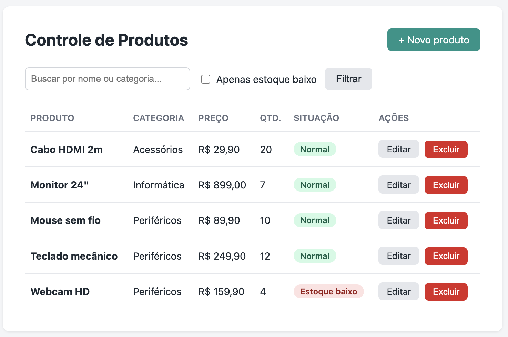

# CRUD de Produtos / Estoque — PHP Puro

Aplicação web para controle simples de produtos e estoque, desenvolvida em **PHP puro**, sem framework, utilizando **PDO** e **MySQL**. O projeto foi criado para praticar fundamentos de desenvolvimento back-end e as operações de um CRUD: Create, Read, Update e Delete.



## Funcionalidades

- Cadastro de produtos
- Listagem de produtos
- Edição e exclusão de produtos
- Busca por nome ou categoria
- Filtro de produtos com estoque baixo
- Indicador visual de estoque baixo
- Mensagens de sucesso e erro usando sessão
- Validação de dados no servidor

## Segurança aplicada

- PDO com prepared statements contra SQL Injection
- Escape de saída com `htmlspecialchars()` contra XSS
- Token CSRF na exclusão de produtos
- Exclusão realizada via requisição `POST`
- Credenciais do banco mantidas em `.env`, fora do versionamento
- Mensagens internas de erro do banco não são exibidas ao usuário
- Apenas a pasta `public/` é exposta pelo servidor web

### Como testei cada proteção

| Ataque | Teste realizado | Resultado |
| --- | --- | --- |
| SQL Injection | Busca por `' OR 1=1 --` | Tratado como texto: nenhum produto encontrado |
| XSS | Produto com nome `<script>alert('x')</script>` | Exibido como texto, sem executar |
| Validação burlada | Remoção do `required` pelo DevTools e preço `abc` | Bloqueado pela validação no servidor |
| Exclusão por GET | Acesso direto a `delete.php` | Resposta 405 (método não permitido) |
| CSRF | Token alterado pelo DevTools | Solicitação recusada, nada excluído |
| Acesso a arquivos sensíveis | Acesso a `/.env` pela URL | Arquivo fora da raiz pública, conteúdo não exibido |

## Tecnologias

- PHP 8+
- MySQL / MariaDB
- PDO
- HTML5
- CSS3
- Git / GitHub

## Estrutura do projeto

```text
crud-produtos-php/
├── config/
│   └── database.php        # conexão PDO (lê o .env)
├── database/
│   └── database.sql        # criação do banco e dados de exemplo
├── docs/
│   └── screenshot.png
├── public/                 # única pasta acessível pelo navegador
│   ├── css/
│   │   └── style.css
│   ├── create.php
│   ├── delete.php
│   ├── edit.php
│   └── index.php
├── src/
│   └── functions.php       # funções auxiliares (escape, flash, CSRF)
├── templates/
│   ├── footer.php
│   └── header.php
├── .env.example
├── .gitignore
└── README.md
```

A pasta `public/` é a raiz do servidor web. Arquivos sensíveis, como o `.env` e as configurações, ficam fora dela e não podem ser acessados pela URL.

## Como executar

### 1. Clone o repositório

```bash
git clone https://github.com/Jadsonsac/crud-produtos-php.git
cd crud-produtos-php
```

### 2. Crie o banco de dados

Com o MySQL em execução, importe o arquivo:

```bash
mysql -u root -p < database/database.sql
```

Você também pode executar o conteúdo de `database/database.sql` pelo MySQL Workbench.

### 3. Configure as credenciais

Copie o arquivo de exemplo:

```bash
cp .env.example .env
```

Depois, ajuste o `.env` de acordo com seu MySQL:

```env
DB_HOST=127.0.0.1
DB_NAME=crud_produtos
DB_USER=root
DB_PASS=sua_senha
```

> O arquivo `.env` está no `.gitignore` e não deve ser enviado ao GitHub.

### 4. Inicie o servidor PHP

```bash
php -S localhost:8000 -t public
```

O parâmetro `-t public` define a pasta `public/` como raiz do servidor. Acesse `http://localhost:8000` no navegador.

## O que pratiquei neste projeto

Este projeto me permitiu praticar PHP sem framework, conexão com banco usando PDO, consultas SQL parametrizadas, validação de formulários, sessões, organização do código em arquivos e cuidados básicos de segurança em aplicações web.

## Melhorias futuras

- Paginação da listagem
- Upload de imagem dos produtos
- Histórico de entrada e saída do estoque
- Autenticação de usuários
- Relatórios de estoque

## Autor

**Jadson Sousa Alves Câmara**  
Estudante de Engenharia de Software

[LinkedIn](https://www.linkedin.com/in/jadsonsac) · [GitHub](https://github.com/Jadsonsac)
